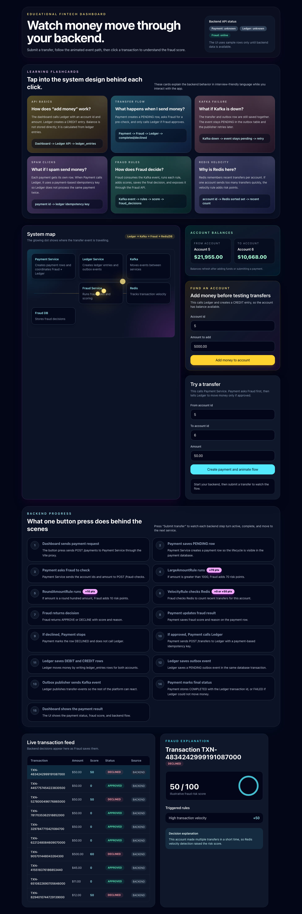
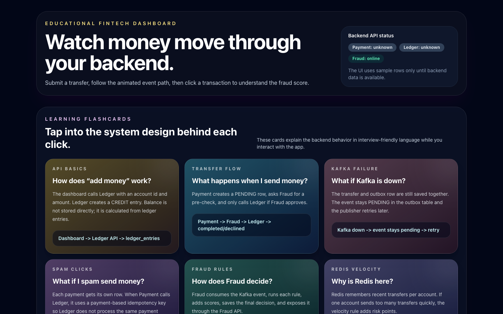
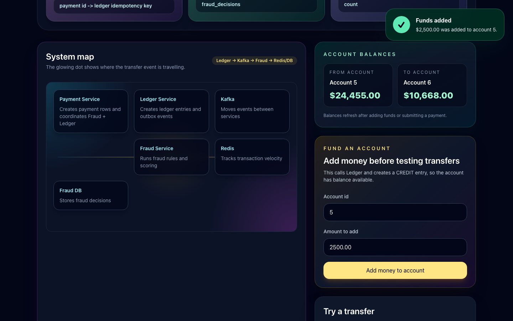
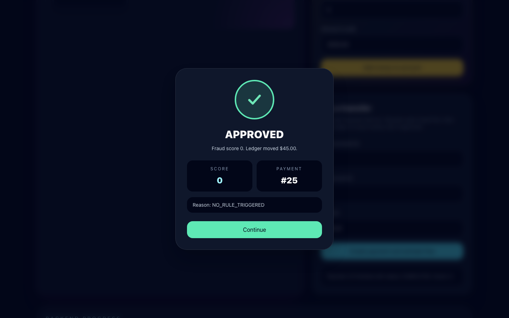
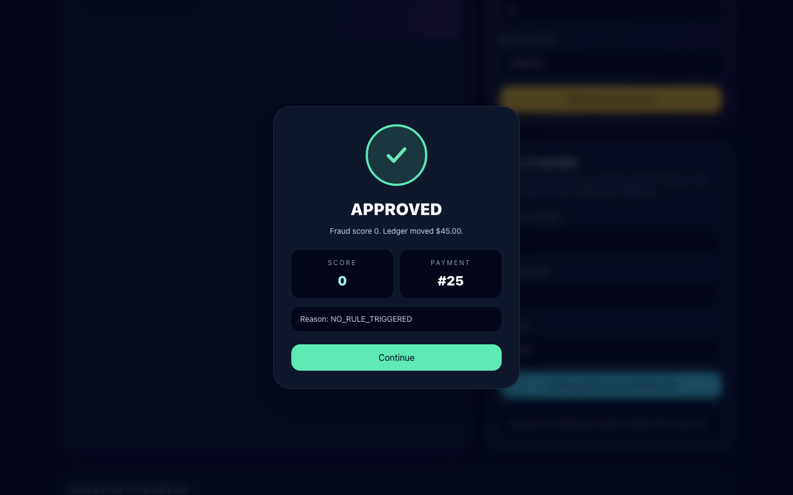
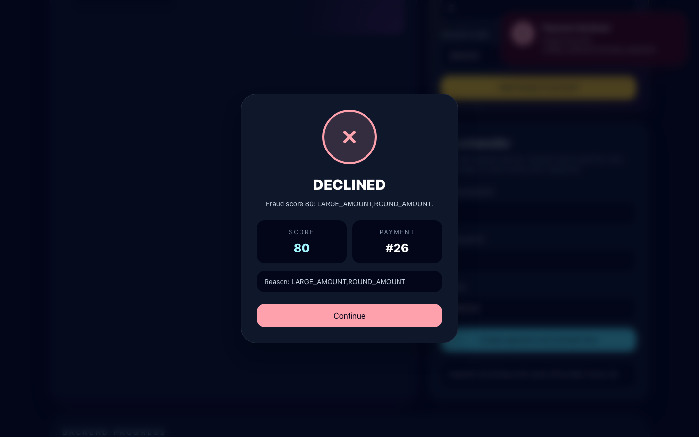
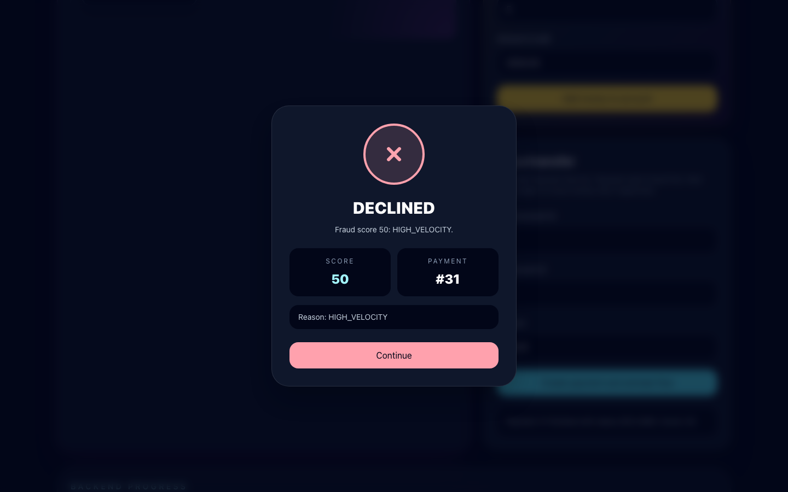
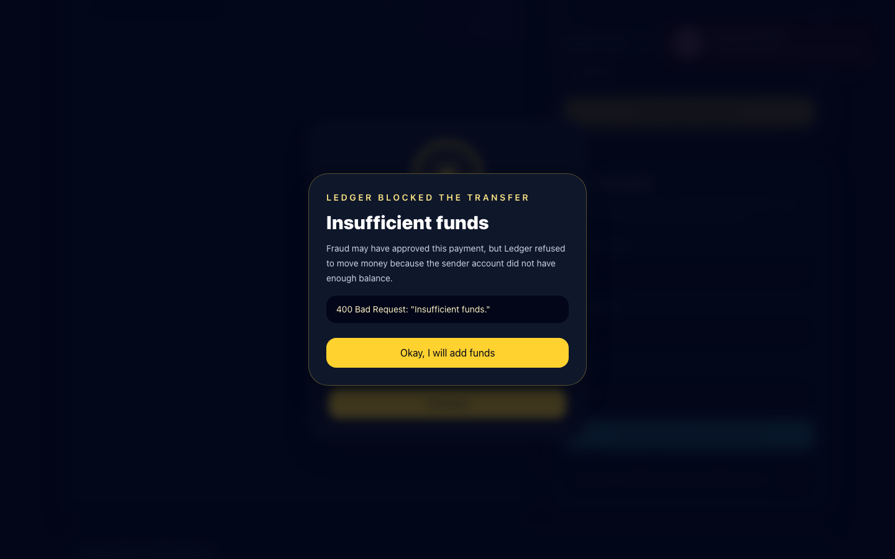
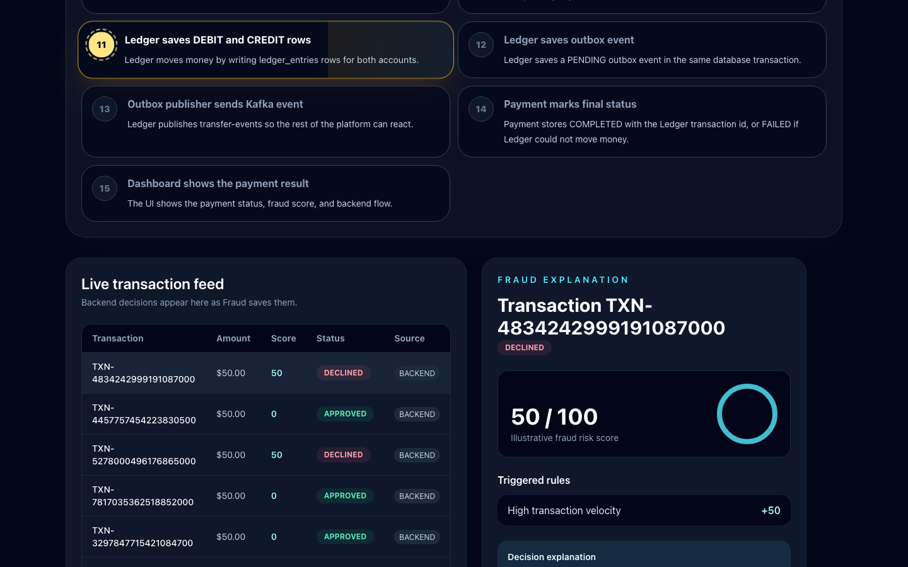

# Fintech Payments Platform

Event-driven payments monorepo with Ledger, Fraud, Payment orchestration, Kafka,
Redis, Postgres, and an educational dashboard.


## Dashboard screenshots

### Overview



### Learning flashcards



### Add money



### Approved transfer



### Backend progress timeline



### Declined — large / round amount



### Declined — Redis velocity (>3 transfers in 5 minutes)



### Insufficient funds



### Fraud explanation panel



## Repository layout

```text
.
├── apps/dashboard/
├── contracts/json-schema/
├── docs/
│   └── demo/                 # screenshots + live demo video
├── infra/compose.yaml
├── observability/
├── scripts/record-dashboard-demo.mjs
├── services/
│   ├── fraud-service/
│   ├── ledger-service/
│   └── payment-service/
├── pom.xml
└── mvnw
```

Services target Java 21 and inherit Spring Boot 4.1.1 from the root Maven parent.

## Build and test

```bash
./mvnw clean verify
```

## Run the platform

Prerequisites: Docker with Compose support.

```bash
docker compose -f infra/compose.yaml up --build
```

- Dashboard: `http://localhost:5173`
- Ledger Service: `http://localhost:8080`
- Fraud Service: `http://localhost:8081`
- Payment Service: `http://localhost:8082`
- Kafka: `localhost:9092`
- Ledger PostgreSQL: `localhost:5432`
- Fraud PostgreSQL: `localhost:5433`
- Payment PostgreSQL: `localhost:5434`
- Redis: `localhost:6379`

## Service documentation

- [Ledger Service](services/ledger-service/README.md)
- [Ledger API](services/ledger-service/API.md)
- [Dashboard](apps/dashboard/README.md)
